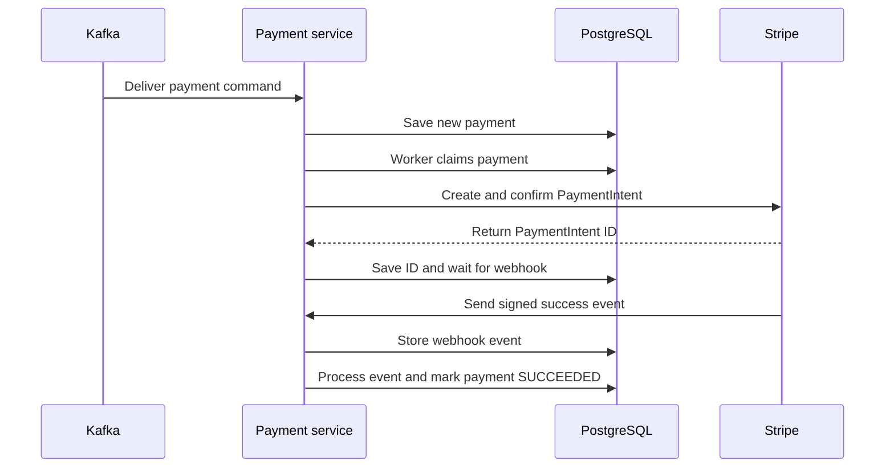

# Async Payment Service

A Spring Boot service that processes card payments in Stripe test mode. The order service sends a payment through Kafka. The payment owner can then check its status through the REST API.

## How a payment works



A customer pays USD 10.00 with a test card. The worker can finish its job (`executionStatus = COMPLETED`) while the payment still shows `AWAITING_WEBHOOK`. Once the service processes the success event from Stripe, the customer sees `paymentStatus = SUCCEEDED`. If the webhook is late, the service checks with Stripe after 15 minutes. [See the end-to-end test](src/test/java/com/example/payment/PaymentFlowTest.java).

## Where to find the code

| Task | Start here |
| --- | --- |
| Register a Kafka payment | [registration](src/main/java/com/example/payment/registration/PaymentListener.java) |
| Pick the next payment | [worker](src/main/java/com/example/payment/worker/PaymentPoller.java) |
| Run one attempt and call Stripe | [worker/attempt](src/main/java/com/example/payment/worker/attempt/PaymentRunner.java) and [stripe](src/main/java/com/example/payment/stripe/StripeGateway.java) |
| Process a Stripe webhook | [webhook](src/main/java/com/example/payment/webhook/StripeWebhookProcessor.java) |
| Handle an HTTP request | [api](src/main/java/com/example/payment/api/PaymentController.java) |
| Store payments and handle database errors | [domain](src/main/java/com/example/payment/domain/Payment.java) and [database](src/main/java/com/example/payment/database) |
| Check payments with Stripe and archive old records | [maintenance](src/main/java/com/example/payment/maintenance/MaintenanceScheduler.java) |
| Collect metrics | [observability](src/main/java/com/example/payment/observability/PaymentMetricsRepository.java) |

## Try one payment

You need Docker Compose, the Stripe CLI and a Stripe test account. Use two terminals in the project folder.

### 1. Start the service

In the first terminal, copy the settings file and get the signing secret for your local Stripe listener.

```sh
cp -n .env.example .env
stripe login
stripe listen --print-secret
```

In `.env`, fill in `POSTGRES_PASSWORD`, `PAYMENT_API_PASSWORD` and `PAYMENT_API_ADMIN_PASSWORD`. Set `STRIPE_SECRET_KEY` to a test key from the same Stripe account. Set `STRIPE_WEBHOOK_SECRET` to the signing secret printed above.

```sh
docker compose up -d --build
API_URL="http://$(docker compose port app 8080)"
stripe listen --events payment_intent.succeeded,payment_intent.payment_failed,payment_intent.canceled,payment_intent.processing,payment_intent.requires_action \
  --forward-to "$API_URL/api/webhooks/stripe"
```

Leave the listener running. Compose picks a free local port for the API.

### 2. Send a test payment

In the second terminal, publish one message. The amount is in cents, so `1000` means USD 10.00. Use the same `paymentOperationId` if you send the same payment again.

```sh
OWNER=$(docker compose exec -T app printenv PAYMENT_API_USERNAME)
EVENT_ID=$(uuidgen)
OPERATION_ID=$(uuidgen)
ORDER_ID=$(uuidgen)

docker compose exec -T kafka kafka-console-producer --bootstrap-server kafka:29092 --topic payments <<EOF
{"eventId":"$EVENT_ID","ownerUsername":"$OWNER","paymentOperationId":"$OPERATION_ID","orderId":"$ORDER_ID","amount":1000,"currency":"usd","paymentMethodId":"pm_card_visa"}
EOF
```

### 3. Read the result

Use the same terminal. Enter the owner's API password when curl asks for it.

```sh
API_URL="http://$(docker compose port app 8080)"
curl -u "$OWNER" "$API_URL/api/payments/by-event-id/$EVENT_ID"
```

A `404` can mean the Kafka message is still in the queue. Wait a few seconds and repeat the GET. Look for `SUCCEEDED` and a `providerPaymentId` that starts with `pi_`.

## HTTP API

For a GET by ID, the controller calls `PaymentQueryService`. It reads the payment from PostgreSQL, checks who can see it and returns the saved status. [Follow the query](src/main/java/com/example/payment/api/PaymentQueryService.java).

| Request | Result |
| --- | --- |
| `GET /api/payments/{id}` | Read the payment and its current status |
| `GET /api/payments/by-event-id/{eventId}` | Find a payment by its original Kafka event ID |
| `POST /api/payments/{id}/retry` | Queue a failed payment again. Returns `204` |
| `POST /api/payments/{id}/payment-method` | Send a new `paymentMethodId` and the current `version` for a declined card. Returns `202` |
| `GET /api/csrf` | Get a CSRF token for the two POST requests above |
| `POST /api/webhooks/stripe` | Receive an event and check its `Stripe-Signature` header |

Use HTTP Basic for customer requests. A user can read and retry their own payments. An admin can read and retry any payment. Only the owner can change the card. For either customer POST, send the CSRF token and its session cookie with the same credentials. A `409` means the payment cannot accept that change now.

Swagger UI is at `/swagger-ui/index.html`. The OpenAPI JSON is at `/v3/api-docs`. Both require an admin account outside the `prod` profile. Compose uses `prod` by default, which disables both. For local API docs, set `SPRING_PROFILES_ACTIVE=local` in `.env` and run `docker compose up -d` again.

## Run and check

- **Tests.** With Java 21 and Docker, run `./mvnw clean verify`. The integration tests start their own PostgreSQL and Kafka containers.
- **Health.** In Compose, other containers can check `http://app:9091/actuator/health/readiness`. Use `/actuator/health/liveness` to check the process. Admins can read `/actuator/metrics` on the same port.
- **Kafka.** By default, each owner can start 10 new payments per minute. Invalid commands go to `payments.DLT`. Sending the same payment again with matching details does not create a second charge.
- **Recovery.** If Stripe times out, the service looks for the original payment before taking further action. A payment that needs 3D Secure shows `REQUIRES_ACTION` and an `actionExpiresAt` deadline. The API does not yet provide the client secret needed for that step.
- **Database.** Flyway applies [versioned migrations](src/main/resources/db/migration) at startup. Add a new migration for each schema change. [Application settings](src/main/resources/application.yml) control retries, cleanup and retention.
- **Local data.** Use `docker compose logs -f app` to read logs and `docker compose down` to stop the service. Adding `-v` also deletes the local database and Kafka volumes.
